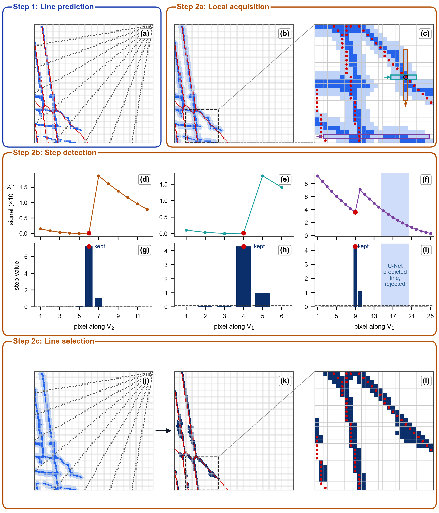
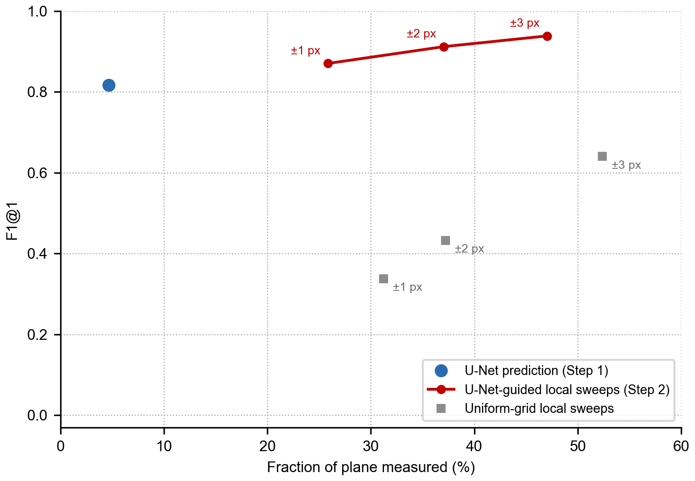
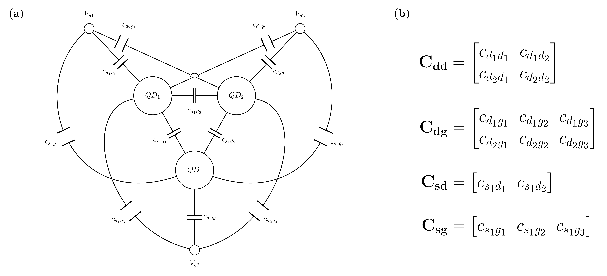
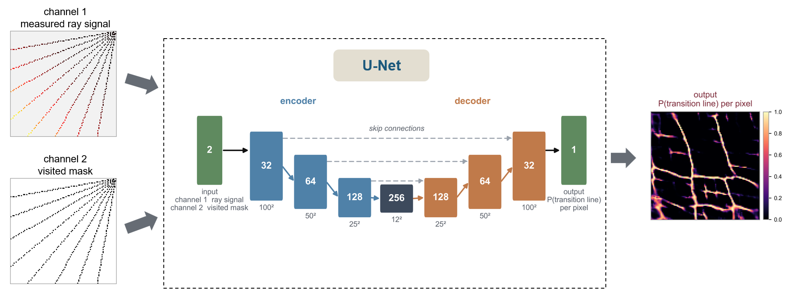

# probabilistic-csd-reconstruction

**Separating where to measure from what is measured: charge stability
diagram reconstruction in double quantum dots.**

E. Alizadeh Kashtiban, T. Fujita, A. Oiwa — The University of Osaka
(Graduate School of Science and SANKEN). Code for the paper of the same
title (preprint link to follow).

The charge configuration of a double quantum dot is set by the transition
lines of its charge stability diagram (CSD), yet a raster scan measures the
whole (V₁, V₂) plane, most of it Coulomb-blockaded. This repository locates
the lines in **two steps**:

1. **Line prediction.** The plane is measured along a few one-dimensional
   rays from one corner. A U-Net, trained only on simulated devices whose
   transition-line labels are exact, turns those traces into a per-pixel
   probability that a transition line passes through each pixel; a
   threshold chosen on validation devices binarizes it.
2. **Line verification.** Short local sweeps (half-width ±w pixels) are
   measured across the predicted lines only, and a pixel is kept as a line
   pixel only where the charge-sensor signal itself shows an abrupt step.
   A false prediction is rejected by the measurement; a line the network
   misses entirely is not swept and is lost.

The network decides **where** to measure; the charge sensor decides
**what** is a transition line. In this work both steps run on noise-free
simulated devices (constant-capacitance model, QArray); Step 2 is designed
to run on a real device, which has not yet been done.



*Verification on one test device. (a) Rays and predicted lines (Step 1).
(b), (c) The strip swept around the predicted lines and three traces.
(d)–(i) Signal along the traces and its step value against the threshold
(dashed): the purple trace crosses a true line (kept) and a false
prediction (rejected). (j)–(l) All measured points and the retained lines
(dark blue) with the true lines (red dots).*

## Install

```bash
git clone https://github.com/Ehsan-Japan/probabilistic-csd-reconstruction
cd probabilistic-csd-reconstruction
pip install -r requirements.txt        # or:  pip install -e .
```

## Reproduce the paper

```bash
# Step 1 -- simulate 550 devices, train one U-Net per ray budget, score it
python scripts/run_1_generate_dataset.py
python scripts/run_2_train_model.py
python scripts/run_3_evaluate_model.py
python scripts/run_4_compare_configs.py
python scripts/run_6_threshold_report.py   # probability maps + threshold
python scripts/run_9_update_readme.py      # rewrites the Step 1 table below

# Step 2 -- local sweeps around the 8 x 60 prediction, and the baseline
python scripts/run_19_two_step.py          # -> two_step/table.csv
python scripts/run_23_equal_seeds.py       # -> two_step/equal_seeds.csv, fig_f1_vs_measured.png
```

`python scripts/run_0_full_sweep.py` runs Step 1 in one command. Every
script, including the side studies (virtual gates, charge-state labelling,
earlier Step 2 variants), is described in
**[`scripts/README.md`](scripts/README.md)**. Results are written to
`results/<run name>/`, which is not tracked; the numbers below are copied
from it.

<!-- RESULTS:BEGIN -->

<!-- Generated by scripts/run_9_update_readme.py — do not edit by hand. -->

## Results

From `results/4-5-6-7-8_rays_40-50-60_points_500_samples/`. 15 measurement budgets, 500 training and 50 held-out devices (disjoint by device ID, seed 12345), 100 × 100 px diagrams.

### Every budget

| rays × points | coverage (%) | threshold | precision | recall | F1@0 | F1@1 |
|---|---|---|---|---|---|---|
| 4 × 40 | 1.57 | 0.6 | 0.617 | 0.719 | 0.335 | 0.660 |
| 5 × 40 | 1.94 | 0.6 | 0.625 | 0.813 | 0.363 | 0.701 |
| 6 × 40 | 2.33 | 0.4 | 0.683 | 0.804 | 0.378 | 0.735 |
| 7 × 40 | 2.72 | 0.3 | 0.700 | 0.819 | 0.396 | 0.747 |
| 8 × 40 | 3.11 | 0.6 | 0.748 | 0.830 | 0.426 | 0.783 |
| 4 × 50 | 1.95 | 0.5 | 0.628 | 0.758 | 0.350 | 0.683 |
| 5 × 50 | 2.44 | 0.7 | 0.709 | 0.773 | 0.394 | 0.736 |
| 6 × 50\* | 2.94 | 0.7 | 0.625 | 0.713 | 0.344 | 0.661 |
| 7 × 50 | 3.42 | 0.7 | 0.696 | 0.796 | 0.396 | 0.738 |
| 8 × 50 | 3.88 | 0.7 | 0.786 | 0.815 | 0.449 | 0.796 |
| 4 × 60 | 2.35 | 0.6 | 0.623 | 0.736 | 0.348 | 0.670 |
| 5 × 60\* | 2.96 | 0.5 | 0.674 | 0.809 | 0.393 | 0.731 |
| 6 × 60 | 3.52 | 0.6 | 0.732 | 0.822 | 0.422 | 0.772 |
| 7 × 60\* | 4.10 | 0.4 | 0.756 | 0.837 | 0.438 | 0.789 |
| **8 × 60**\* | 4.66 | 0.6 | 0.806 | 0.836 | 0.469 | **0.817** |

Budgets marked \* were retrained from a different random initialisation.

The threshold is not 0.5 and is not tuned on the test devices: it is chosen on a validation split carved out of the training devices and stored in the checkpoint.

### Tolerance sweep — 8 rays × 60 points

| τ | precision@τ | recall@τ | F1@τ | coverage@τ |
|---|---|---|---|---|
| 0 | 0.412 | 0.554 | 0.469 | 4.66 % |
| **1** | 0.806 | 0.836 | **0.817** | 18.91 % |
| 2 | 0.905 | 0.912 | 0.905 | 33.12 % |
| 3 | 0.947 | 0.950 | 0.946 | 47.37 % |

`coverage@τ` is how far the measurement itself reaches at that tolerance: the fraction of the plane within τ pixels of a measured pixel. At τ = 0 it is the plain coverage, 4.66 %. Read the two columns together — a tolerant score is only evidence of recovery while the tolerance stays small against the plane.

Per-device spread at this budget: F1@1 mean 0.817, sd 0.138, min 0.281, max 0.945 over 50 held-out devices. Pixel accuracy is not reported as a result — predicting no line anywhere already scores 92.9 %.

<!-- RESULTS:END -->

## Step 2 results — local sweeps around the prediction

From `results/4-5-6-7-8_rays_40-50-60_points_500_samples/two_step/table.csv`
(`run_19_two_step.py`) and `equal_seeds.csv` (`run_23_equal_seeds.py`).
8 rays × 60 points, 50 held-out test devices; measured = fraction of the
plane measured by the rays and the sweeps together. Every detector
threshold is chosen on the 75 validation devices; the test devices only
report.

| method | measured (%) | precision | recall | F1@1 |
|---|---|---|---|---|
| U-Net prediction (Step 1) | 4.7 | 0.806 | 0.836 | 0.817 |
| U-Net-guided local sweeps, ±1 px | 25.9 | 0.940 | 0.815 | 0.870 |
| uniform-grid local sweeps, every 4 px | 31.2 | 0.636 | 0.244 | 0.338 |
| **U-Net-guided local sweeps, ±2 px** | 37.0 | 0.915 | 0.915 | **0.912** |
| uniform-grid local sweeps, every 6 px | 37.2 | 0.893 | 0.295 | 0.432 |
| U-Net-guided local sweeps, ±3 px | 47.0 | 0.948 | 0.935 | 0.938 |
| uniform-grid local sweeps, every 7 px | 52.4 | 0.865 | 0.533 | 0.640 |

The uniform-grid rows are the same sweeps and the same detector placed
around a square grid of points instead of the predicted lines, without
rays, each measuring at least as much of the plane as the guided row above
it. They isolate what the U-Net contributes.

Two further baselines from the same `table.csv`, which the paper does not
tabulate:

| method | measured (%) | precision | recall | F1@1 |
|---|---|---|---|---|
| coarse raster 51 × 51 + step detector | 26.0 | 0.880 | 0.810 | 0.819 |
| coarse raster 61 × 61 + step detector | 37.2 | 0.812 | 0.786 | 0.770 |
| coarse raster 69 × 69 + step detector | 47.6 | 0.807 | 0.810 | 0.781 |
| full scan + step detector | 100.0 | 0.946 | 0.969 | **0.953** |

Read these against the guided rows: the full scan still scores highest, at
roughly twice the cost of the ±3 px sweeps. A strip of ±0 px (sweeping only
the predicted pixels) measures 13.9 % and scores F1@1 = 0.702, below the
U-Net alone, so it is not used.



*F1@1 against the fraction of the plane measured, averaged over the 50 test
devices. Blue: U-Net prediction (Step 1). Red: U-Net-guided local sweeps,
±1, ±2, ±3 px (Step 2). Grey: the same sweeps around a uniform grid of
points spaced 4, 6 and 7 px apart, without the U-Net.*

## Device model



*The constant-capacitance model of the simulated device (Fig. 2 of the paper). **(a)** The capacitor network: two quantum dots QD₁ and QD₂, a sensor dot QD_s, and three gates. **(b)** The four capacitance matrices that define a device. A device is one uniform draw of the 14 free parameters listed below.*

Each simulated device is a double quantum dot (DQD) capacitively coupled to
a single charge sensor, modelled with the QArray simulator in the
constant-capacitance approximation: the device is a network of fixed
capacitors, and for a gate-voltage vector V_g the ground-state charge
configuration n = (n₁, n₂) is the integer occupation that minimises the
electrostatic energy of the network. The transition lines of the stability
diagram are where two charge configurations are degenerate.

Each of the three islands (two dots and the sensor) couples to each of the
three gates — nine branches — and the islands couple to one another through
c_d1d2, c_s1d1 and c_s1d2 — three more, twelve drawn in (a). The
self-capacitances c_d1d1 and c_d2d2 are not drawn, so a device is specified
by **14 capacitances**, collected into four matrices: C_dd (2 × 2,
symmetric, so c_d1d2 = c_d2d1), C_dg (2 × 3), C_sd (1 × 2) and C_sg
(1 × 3). Every entry is drawn independently and uniformly from its interval,
in QArray's dimensionless capacitance units:

| matrix | entry | interval |
|---|---|---|
| C_dd | c_d1d1 | 0.30 – 1.40 |
| C_dd | c_d2d2 | 0.30 – 1.40 |
| C_dd | c_d1d2 | 0.20 – 2.00 |
| C_dg | c_d1g1 | 0.80 – 6.00 |
| C_dg | c_d2g2 | 0.80 – 6.00 |
| C_dg | c_d1g2 | 0.05 – 0.60 |
| C_dg | c_d2g1 | 0.05 – 0.60 |
| C_dg | c_d1g3 | 0.01 – 0.10 |
| C_dg | c_d2g3 | 0.01 – 0.10 |
| C_sd | c_s1d1 | 0.02 – 0.15 |
| C_sd | c_s1d2 | 0.02 – 0.15 |
| C_sg | c_s1g1 | 0.02 – 0.10 |
| C_sg | c_s1g2 | 0.02 – 0.10 |
| C_sg | c_s1g3 | 0.10 – 1.00 |

No sampled device is filtered or rejected. Training and test devices are
drawn from the same intervals and are separated by device identity only.
The intervals are `DEFAULT_INTERVALS` in
`src/csdrecon/config/capacitance_config.py`; this table is that dictionary.

## Method



*Two input channels on the 100 × 100 grid — the sensor value at
ray-visited pixels, and the binary visited mask — through a depth-3
U-Net (32 → 64 → 128, 256-channel bottleneck; 100² → 50² → 25² → 12²,
skip connections) to a sigmoid head returning P(transition line) per
pixel over the whole plane, measured or not.*

| | |
|---|---|
| **Simulator** | QArray, constant-capacitance model (above): 14 capacitances per device, drawn uniformly from the intervals in the table. The ground truth is the exact charge-state boundary from the simulator, not an edge-detected image. Noise-free (NoNoise, nothing added afterwards). 550 devices: 500 training (75 of them validation), 50 held out. |
| **Window** | a 2 × 2 mV window, shifted at random per device by up to 35 % of its width along each axis, so the transition lines do not appear at fixed positions in the frame. 100 × 100 px. |
| **Measurement** | `n_rays × n_points` samples along rays from one corner. Rays are oblique, so one ray crosses both families of honeycomb edges. |
| **Network input** | 2 channels: the raw sensor value where a ray passed, and a visited mask, so "measured and low" is distinguishable from "never measured". |
| **Network** | fully convolutional U-Net, depth 3 (32→64→128, bottleneck 256), sigmoid head → one probability per pixel; 1 949 409 trainable parameters, the same for every budget. One model is trained per budget, 50 epochs, keeping the epoch with the best validation F1@1. |
| **Loss** | BCEWithLogits with the positive class weighted by its rarity (capped at 8) + soft Dice. Adam 1e-3, batch 16. |
| **Step 2** | local sweeps of half-width ±w (w = 1, 2, 3 px) around the binarized U-Net output, acquired row by row; every swept pixel is tested by the 3-pixel step detector r_k = \|d_k − d_{k−1}\| / (\|d_{k−1}\| + s), along each gate direction in which both neighbours were measured. One detector threshold, chosen on the validation devices. |
| **Metric** | tolerant **F1@τ**: a predicted pixel counts when a true line pixel lies within τ, and vice versa. τ = 0…3 are all reported. |

## Limitations

- Training and evaluation use **noise-free** constant-capacitance
  simulations. Sensor noise, charge switching, drift and lines curved by
  finite tunnel coupling are absent; transfer to fabricated devices is
  untested.
- Step 2 is run on the **simulated** charge-sensor signal, not on a device.
- One voltage window (2 × 2 mV) and resolution (100 × 100 px) throughout.
- Each ray budget was trained once (four of them re-trained from another
  seed after they failed to converge); run-to-run variation was not measured.
